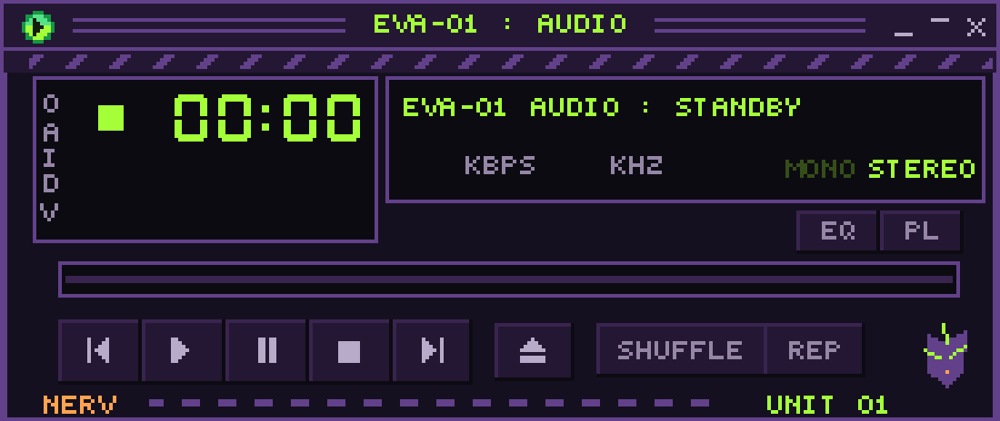

# EVA-01 Audio · Spotifast

Spotifast 0.13.0 con temas Evangelion, skin NERV e instaladores para Linux y Windows. Incluye el código original en `upstream/`, sin modificaciones al motor de audio, y conserva su licencia MIT y autoría.



## Instalar en Linux

Cierra Spotifast antes de instalar. Necesitas Python 3.9 o posterior, conexión a Internet y Linux x86_64 o ARM64 compatible con el AppImage oficial. La base del binario es glibc 2.39 (Ubuntu 24.04 o posterior). No necesita compilar Rust ni instalar como administrador.

```bash
git clone https://github.com/XFunBox/spotifast-eva01.git
cd spotifast-eva01
bash install-linux.sh
```

Abre **EVA-01 Audio** desde el menú. Instala en tu directorio personal, respeta `XDG_CONFIG_HOME` y `XDG_DATA_HOME`, y crea un acceso de escritorio. Si falta `libfuse.so.2`, en Ubuntu 24.04 instala `libfuse2t64`, o inicia el AppImage con el método de extracción descrito en [docs/DEPLOYMENT.md](docs/DEPLOYMENT.md).

```bash
bash install-linux.sh --dry-run
bash install-linux.sh --theme 'EVA-01 Terminal'
bash install-linux.sh --restore
```

## Instalar en Windows

Windows 10/11 de 64 bits o ARM64. No necesitas Python ni permisos de administrador. Descarga y descomprime el repositorio o clónalo con Git. Cierra Spotifast, abre PowerShell en la carpeta y ejecuta:

```powershell
powershell.exe -NoProfile -ExecutionPolicy Bypass -File .\eva\install-windows.ps1
```

El acceso **EVA-01 Audio** aparece en el menú Inicio. La opción de ejecución se aplica a ese proceso; no cambia la política del sistema.

```powershell
powershell.exe -NoProfile -ExecutionPolicy Bypass -File .\eva\install-windows.ps1 -DryRun
powershell.exe -NoProfile -ExecutionPolicy Bypass -File .\eva\install-windows.ps1 -Theme 'EVA-01 Terminal'
powershell.exe -NoProfile -ExecutionPolicy Bypass -File .\eva\restore-windows.ps1
```

Al ser un repositorio privado, clonar o descargar el código requiere una cuenta autorizada. Puedes copiar el paquete descargado a tus otros equipos; los instaladores obtienen el reproductor desde la publicación pública oficial.

## Temas y controles

- **EVA-01**: negro, morado y verde vivo.
- **EVA-01 Terminal**: negro verdoso y verde vivo.
- **EVA-01.wsz**: skin clásica completa, 15 hojas de sprites, títulos de consola NERV y ecualizador AT FIELD.

**Ctrl + M** alterna biblioteca y minirreproductor. **EQ** abre el ecualizador, **PL** la cola, y el menú contextual del título ajusta el tamaño. Si todavía no has conectado la cuenta, inicia sesión desde la ventana principal. La reproducción local depende de Spotify Premium y de las capacidades de Spotifast.

Los instaladores fusionan las preferencias de aspecto y cambian el nombre visible en Spotify Connect a «EVA-01 Audio». No incluyen cuentas, credenciales, listas privadas ni el contenido del equipo que creó este repositorio. Guardan los ajustes visuales anteriores y una copia de cualquier recurso homónimo que sustituyan. La restauración recupera las preferencias y conserva los recursos instalados para poder reutilizarlos.

La skin y paleta principal se pueden regenerar con `python3 eva/build_theme.py` (necesita Pillow). Los instaladores solo necesitan los recursos ya incluidos.

## Código, versión y validación

El código de `upstream/` corresponde a `crmne/spotifast`, tag **v0.13.0**, commit `36964f19e2fb1154d5e87973d76928c7ddbeaf06`. Para compilarlo, sigue [upstream/README.md](upstream/README.md) y [upstream/CONTRIBUTING.md](upstream/CONTRIBUTING.md), desde esa carpeta. Los instaladores usan los binarios oficiales; no recompilan el programa.

[Documentación de despliegue](docs/DEPLOYMENT.md) · [Validación](docs/VERIFICATION.md) · [Licencia](LICENSE) · [Procedencia](NOTICE.md).

La integración continua comprueba Linux y Windows, preservación/restauración de ajustes y descarga/arranque del binario fijado. Las pruebas de instalación no inician sesión ni reproducen música. La imagen superior es una composición de la skin en reposo.
